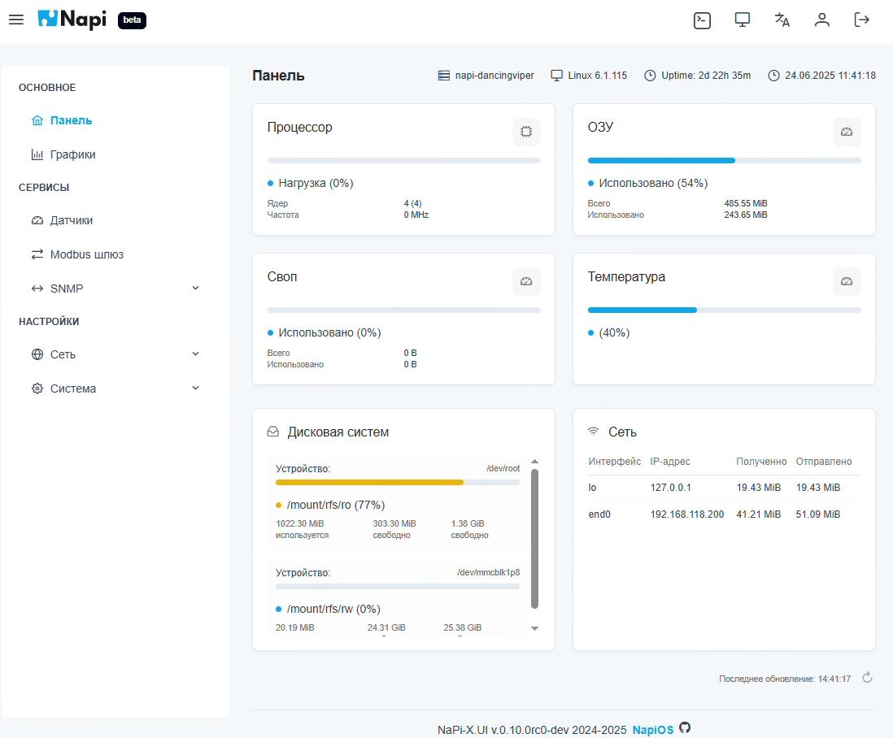
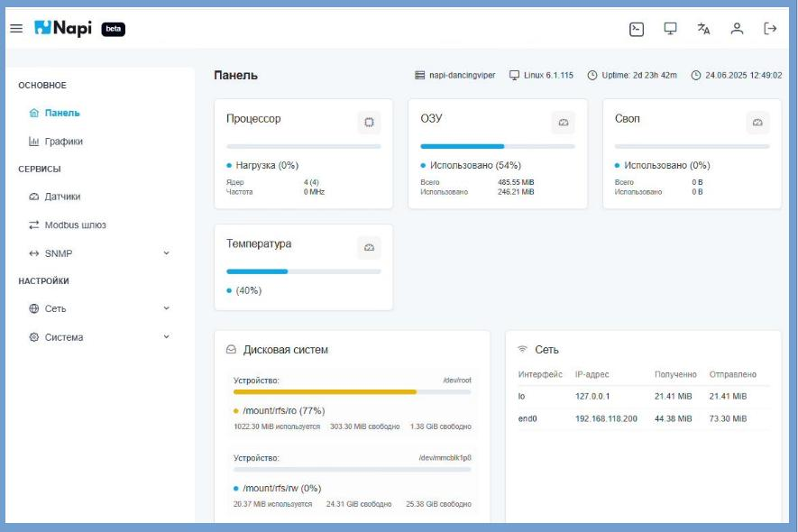

# Панель

После входа открывается **Панель** — сводка о состоянии устройства.

В верхней строке показаны имя устройства, версия ядра Linux, время работы (uptime), текущие дата и время.

Карточки панели:

- **Процессор** — нагрузка, число ядер, частота;
- **ОЗУ** — сколько памяти всего и сколько занято;
- **Своп** — использование файла подкачки;
- **Температура** — температура процессора;
- **Дисковая система** — заполненность разделов: системного раздела только для чтения (`/mount/rfs/ro`) и пользовательского раздела (`/mount/rfs/rw`);
- **Сеть** — сетевые интерфейсы, их IP-адреса и объём принятого и отправленного трафика.

На широком экране карточки выстраиваются в три колонки:

Данные обновляются автоматически. Время последнего обновления показано внизу справа, рядом — кнопка ручного обновления.
