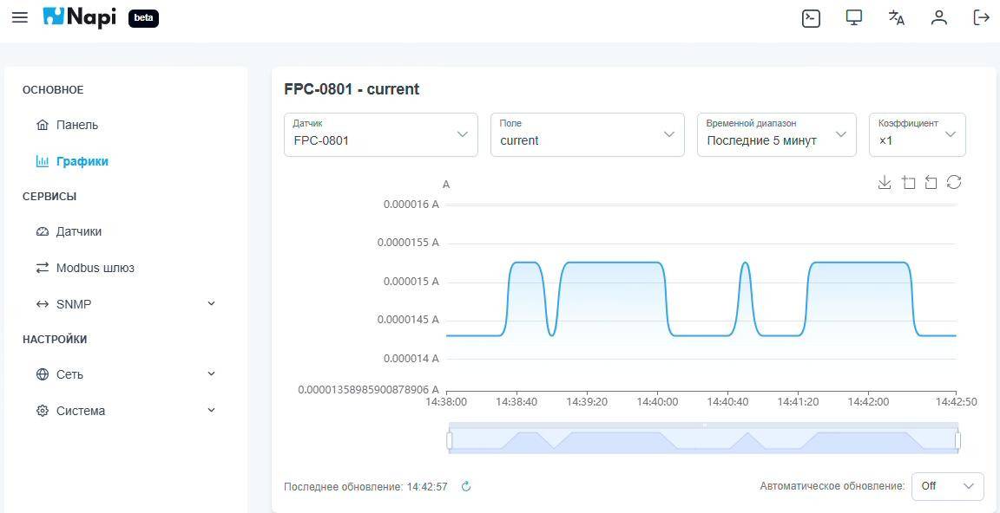
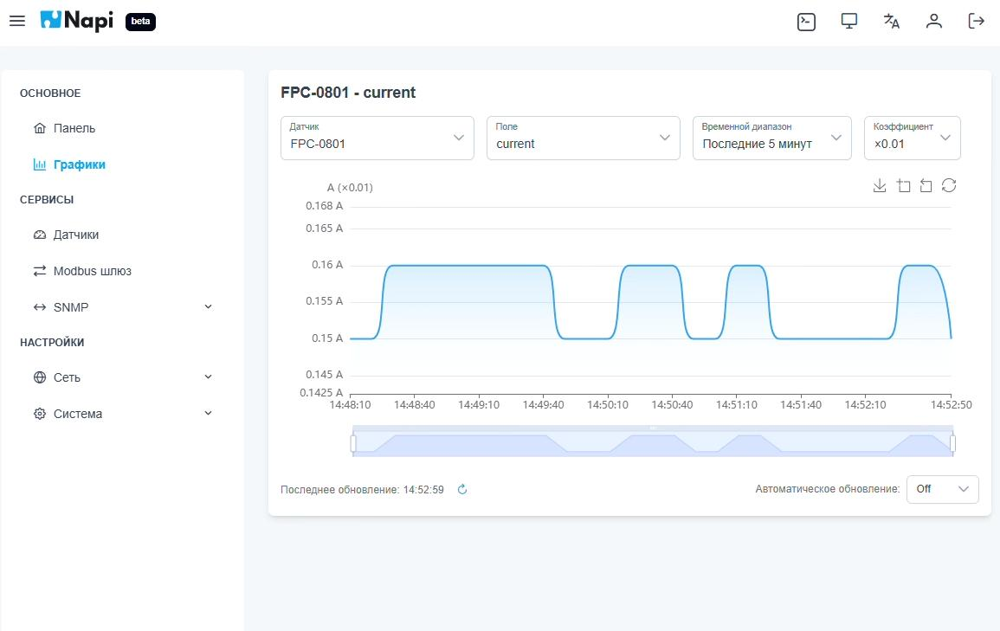
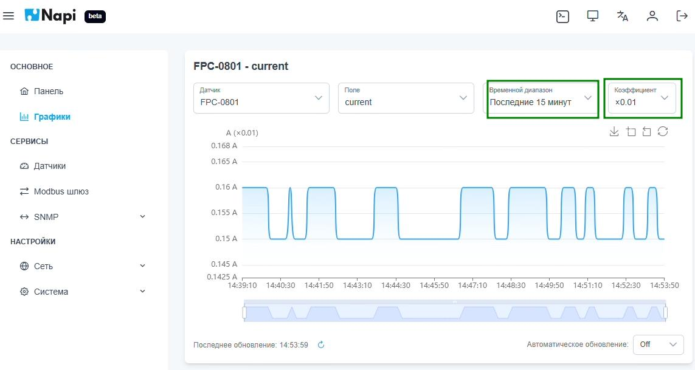

# Графики

Раздел **Основное → Графики** показывает данные датчиков, собранные в InfluxDB.

Над графиком выбираются:

- **Датчик** — источник данных (measurement);
- **Поле** — величина, например `current`, `voltage`, `freq`;
- **Временной диапазон** — например «Последние 5 минут» или «Последние 15 минут»;
- **Коэффициент** — множитель, на который умножаются значения.

## Масштабирование значений

Многие устройства передают «сырые» целые числа. Например, ток в сотых долях ампера. Множитель переводит их в нормальные единицы прямо на графике, без правки конфигурации датчика. На скриншоте ниже выбран коэффициент ×0.01, подпись оси показывает `A (×0.01)`:

## Изменение интервала

Если увеличить временной диапазон, на графике будет видна более длинная история:

## Работа с графиком

- Ползунок под графиком задаёт видимый участок: его можно приблизить и сдвинуть.
- Кнопки над графиком: сохранить график как изображение, выделить область для масштабирования, сбросить масштаб, обновить.
- **Автоматическое обновление** внизу справа периодически перерисовывает график. По умолчанию оно выключено (`Off`).
