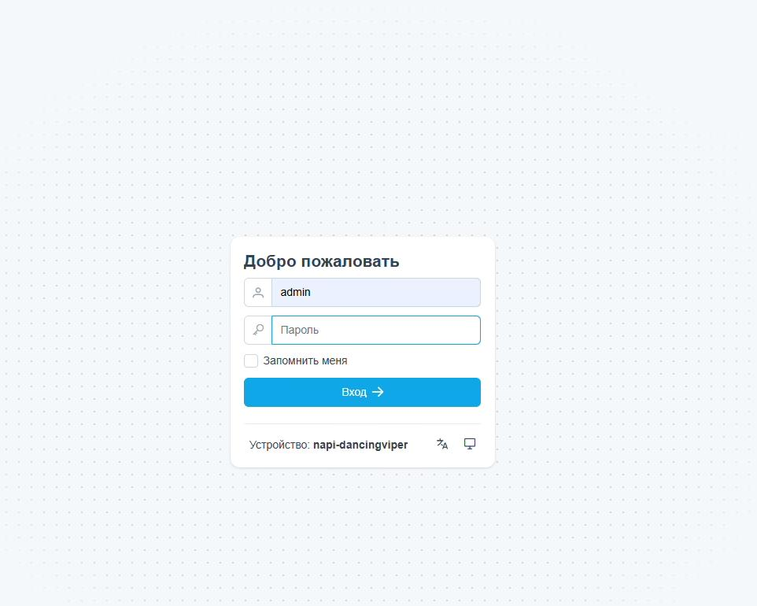
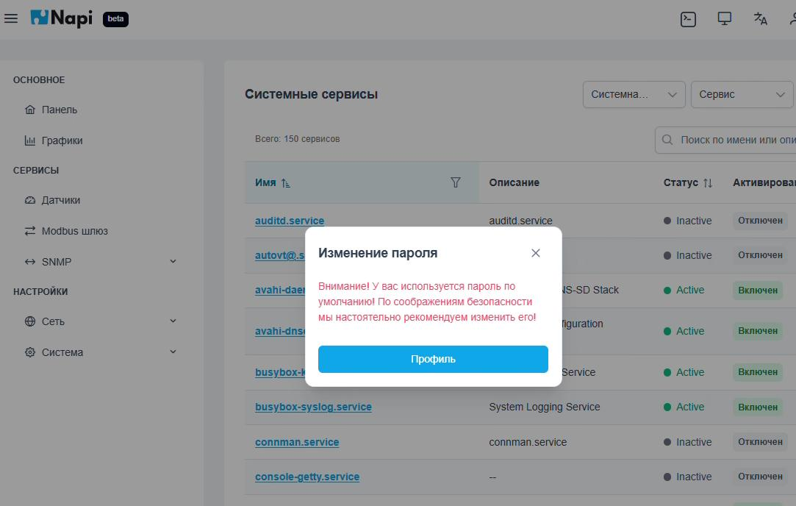
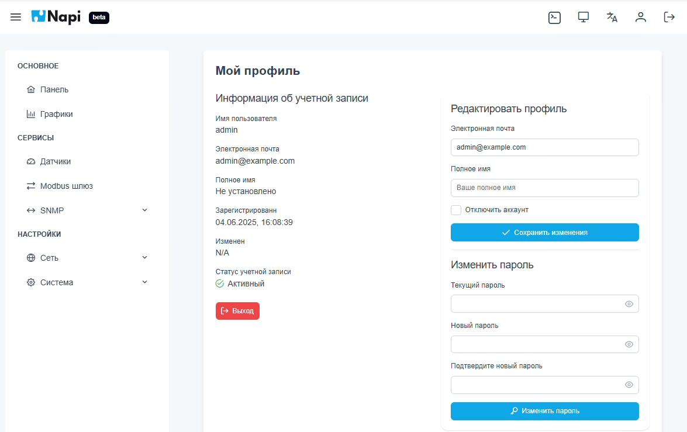

# NapiConfig

> **NapiConfig** — веб-интерфейс управления устройством на NapiLinux. Работает поверх Napi.Api, построен на Vue и FastAPI, доступен по HTTPS на порту 443.

Через NapiConfig можно:

- следить за состоянием устройства — [Панель](./dashboard);
- настраивать сетевые интерфейсы — [Сеть](./network);
- подключать датчики и проверять их конфигурацию — [Датчики](./sensors);
- смотреть данные датчиков на графиках — [Графики](./graphs);
- настраивать шлюз Modbus RTU → Modbus TCP — [Modbus-шлюз](./modbus-gateway);
- настраивать шлюз SNMP v2c → SNMP v3 — [SNMP-шлюз](./snmp-gateway);
- управлять службами Linux и читать их логи — [Службы и логи](./services);
- настраивать время и выполнять сброс к заводским настройкам — [Система](./system);
- работать в консоли устройства прямо из браузера — [Терминал](./terminal).

## Вход в систему

Откройте в браузере адрес устройства:

> https://ip_устройства

Браузер предупредит о самоподписанном сертификате — подтвердите переход (подробнее в разделе [NapiConfig: первый запуск](/docs/enable-web)).

Логин и пароль по умолчанию: **admin / admin**. Внизу формы входа показано имя устройства, там же можно переключить язык интерфейса.

Пока используется пароль по умолчанию, после входа появляется предупреждение. Кнопка **Профиль** открывает страницу смены пароля.

## Профиль пользователя

На странице **Мой профиль** можно:

- посмотреть данные учётной записи: имя пользователя, почту, дату регистрации, статус;
- изменить электронную почту и полное имя;
- сменить пароль (текущий пароль, новый пароль и подтверждение).

:::tip
Смените пароль администратора сразу после первого входа.
:::

## Устройство интерфейса

Слева — меню разделов:

- **Основное** — Панель, Графики;
- **Сервисы** — Датчики, Modbus шлюз, SNMP;
- **Настройки** — Сеть, Система.

Справа вверху — кнопки быстрого доступа: веб-терминал, переключение темы, выбор языка, профиль и выход.
