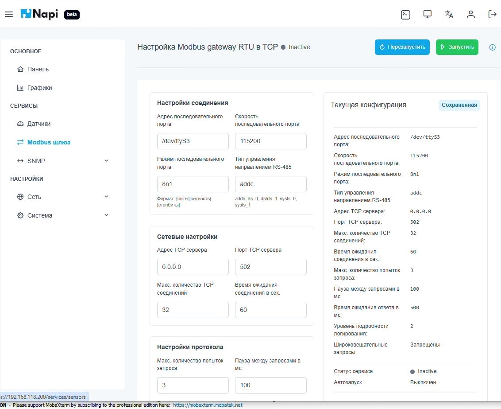

# Шлюз Modbus RTU → Modbus TCP

Раздел **Сервисы → Modbus шлюз** превращает устройство в шлюз: Modbus RTU-устройства на шине RS-485 становятся доступны по сети через Modbus TCP. Так SCADA-система или другой TCP-клиент может опрашивать RTU-устройства без отдельного аппаратного шлюза.

Вверху страницы показан статус службы шлюза (`Active` / `Inactive`) и кнопки **Запустить** / **Перезапустить**.

## Настройки соединения (RS-485)

| Параметр | Пример | Описание |
|---|---|---|
| Адрес последовательного порта | `/dev/ttyS3` | Порт, к которому подключена шина RS-485 |
| Скорость последовательного порта | `115200` | Скорость обмена, бод |
| Режим последовательного порта | `8n1` | Формат: биты данных, чётность, стоп-биты |
| Тип управления направлением RS-485 | `addc` | Способ переключения приём/передача: `addc`, `rts_0`, `rts`/`rts_1`, `sysfs_0`, `sysfs_1` |

## Сетевые настройки (TCP)

| Параметр | Пример | Описание |
|---|---|---|
| Адрес TCP-сервера | `0.0.0.0` | На каком адресе слушать (`0.0.0.0` — на всех интерфейсах) |
| Порт TCP-сервера | `502` | Стандартный порт Modbus TCP |
| Макс. количество TCP-соединений | `32` | Сколько клиентов могут подключиться одновременно |
| Время ожидания соединения, с | `60` | Через сколько секунд закрывать неактивное соединение |

## Настройки протокола

| Параметр | Пример | Описание |
|---|---|---|
| Макс. количество попыток запроса | `3` | Сколько раз повторять запрос к RTU-устройству |
| Пауза между запросами, мс | `100` | Интервал между запросами на шине |
| Время ожидания ответа, мс | `500` | Сколько ждать ответа от RTU-устройства |
| Уровень подробности логирования | `2` | Детальность журнала службы |
| Широковещательные запросы | Запрещены | Пропускать ли broadcast-запросы на шину |

Справа на странице — блок **Текущая конфигурация**: сохранённые параметры, статус службы и признак автозапуска.
