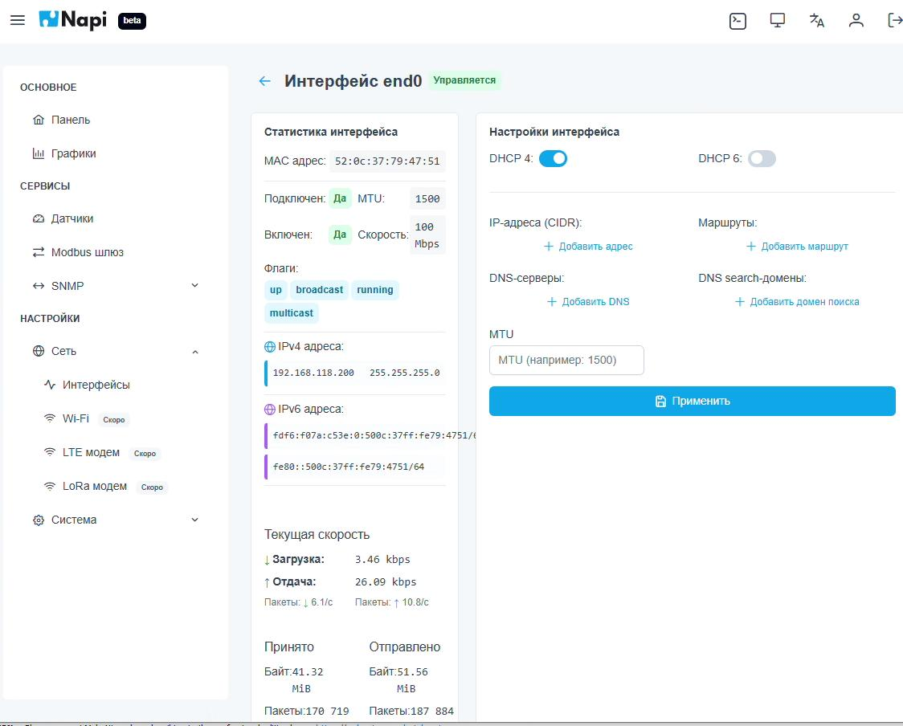

# Сетевые интерфейсы

Раздел **Настройки → Сеть → Интерфейсы** показывает сетевые интерфейсы устройства. Если выбрать интерфейс, откроется его страница.

## Статистика интерфейса

Левая колонка показывает текущее состояние интерфейса:

- MAC-адрес, MTU, скорость соединения;
- подключён ли кабель и включён ли интерфейс;
- флаги (`up`, `broadcast`, `running`, `multicast`);
- назначенные адреса IPv4 и IPv6;
- текущая скорость загрузки и отдачи, пакеты в секунду;
- сколько всего принято и отправлено байт и пакетов.

## Настройки интерфейса

В правой колонке задаются:

- **DHCP 4 / DHCP 6** — автоматическое получение адреса по IPv4 и IPv6;
- **IP-адреса (CIDR)** — статические адреса, например `192.168.1.10/24`;
- **Маршруты**;
- **DNS-серверы** и **DNS search-домены**;
- **MTU**.

Чтобы изменения вступили в силу, нажмите **Применить**.

:::caution
Если вы изменили адрес интерфейса, через который подключены к устройству, связь с NapiConfig прервётся. Откройте интерфейс заново по новому адресу.
:::

Пункты Wi-Fi, LTE-модем и LoRa-модем помечены в меню как «Скоро» — они появятся в следующих версиях.
