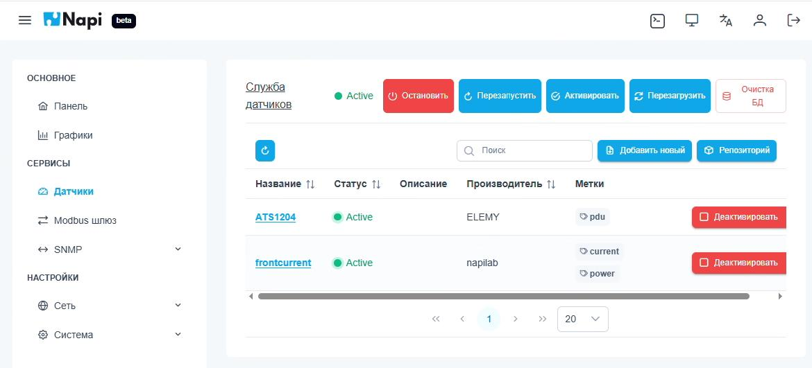
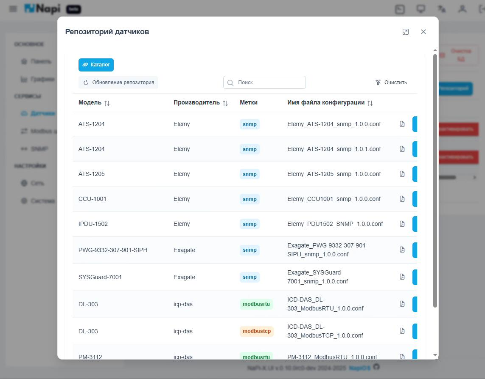
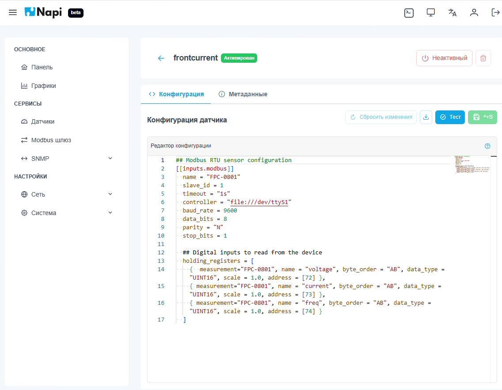
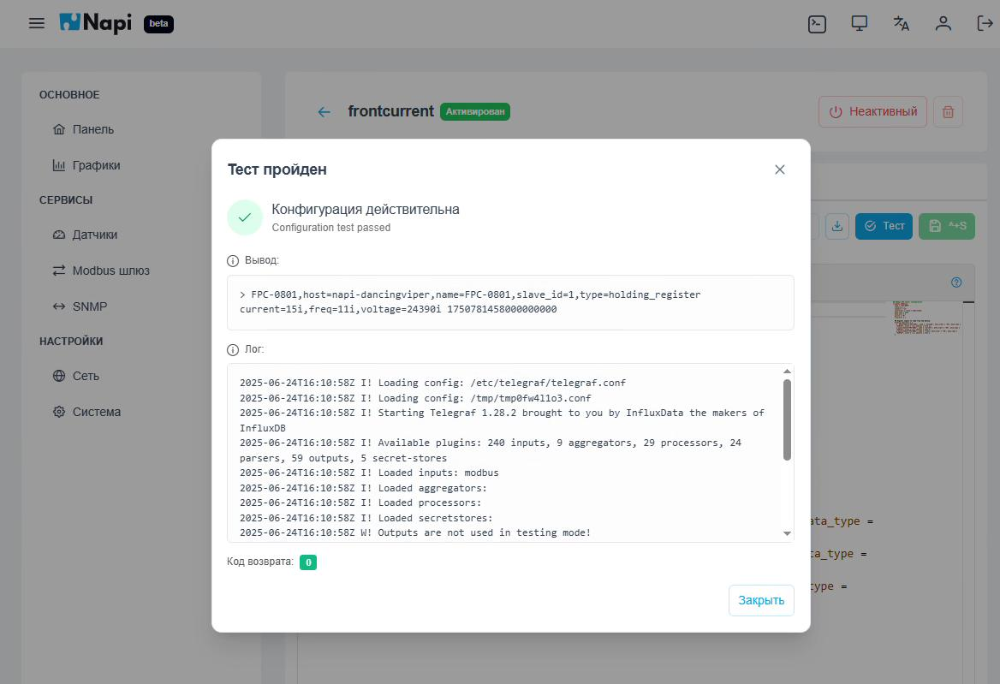
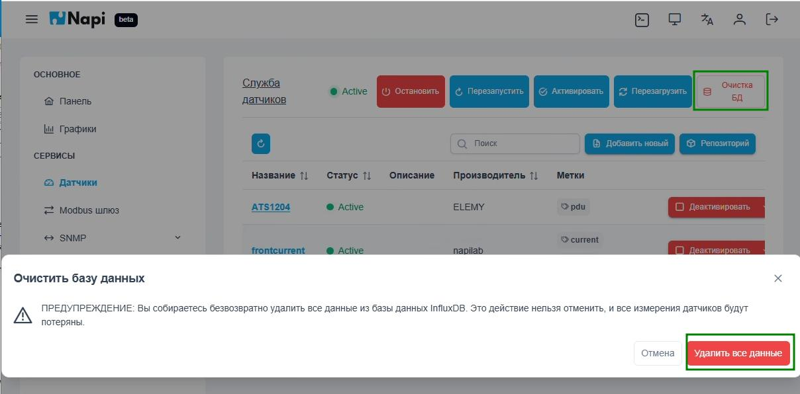

# Датчики

Раздел **Сервисы → Датчики** нужен, чтобы подключать устройства и датчики (Modbus RTU/TCP, SNMP и др.) к системе сбора данных. Данные собирает служба **Telegraf** и сохраняет их в базу **InfluxDB**. Каждый датчик описывается своим файлом конфигурации Telegraf.

## Список датчиков

Вверху страницы — состояние **службы датчиков** и кнопки управления ею:

- **Остановить** / **Перезапустить** службу;
- **Активировать** — включить автозапуск;
- **Перезагрузить** — перечитать конфигурацию;
- **Очистка БД** — удалить накопленные данные (см. ниже).

В таблице для каждого датчика указаны название, статус, описание, производитель и метки. Датчик можно **деактивировать**: тогда его конфигурация сохраняется, но данные по нему не собираются.

Новый датчик можно добавить двумя способами: **Добавить новый** — написать конфигурацию вручную, **Репозиторий** — взять готовую.

## Репозиторий датчиков

В репозитории собраны готовые конфигурации для распространённых устройств: ИБП, PDU, модулей ввода-вывода и т. п. Список можно искать и сортировать по модели, производителю и протоколу (метки `snmp`, `modbusrtu`, `modbustcp`). Кнопка **Обновление репозитория** загружает свежий каталог.

Выбранную конфигурацию можно установить на устройство и затем отредактировать под свою схему подключения.

## Редактирование конфигурации

На странице датчика есть две вкладки: **Конфигурация** и **Метаданные**. Конфигурация пишется в формате Telegraf (TOML). Редактор подсвечивает синтаксис.

В примере на скриншоте настроен опрос Modbus RTU-устройства через порт `/dev/ttyS1`: скорость 9600, 8N1, slave id 1, чтение трёх holding-регистров (напряжение, ток, частота).

Кнопки панели редактора:

- **Сбросить изменения** — вернуть сохранённую версию;
- **Скачать** — сохранить файл конфигурации на компьютер;
- **Тест** — проверить конфигурацию (см. ниже);
- **Сохранить** (`Ctrl+S`).

Вверху справа — переключатель активности датчика и кнопка удаления.

## Проверка конфигурации «на лету»

Кнопка **Тест** запускает Telegraf в тестовом режиме только с этой конфигурацией. Данные при этом в базу не пишутся. В окне результата показаны:

- итог проверки: конфигурация действительна или нет;
- **Вывод** — значения, которые удалось прочитать с устройства;
- **Лог** Telegraf и код возврата.

Так ещё до сохранения можно убедиться, что устройство отвечает и регистры читаются правильно.

## Очистка базы данных

Кнопка **Очистка БД** удаляет все измерения из InfluxDB. Перед удалением появляется окно с предупреждением.

:::danger
Очистка необратима: все накопленные измерения всех датчиков будут удалены.
:::
