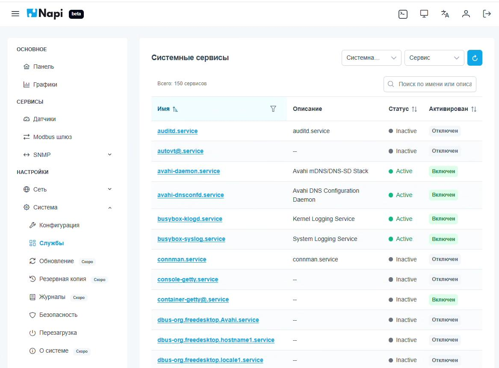
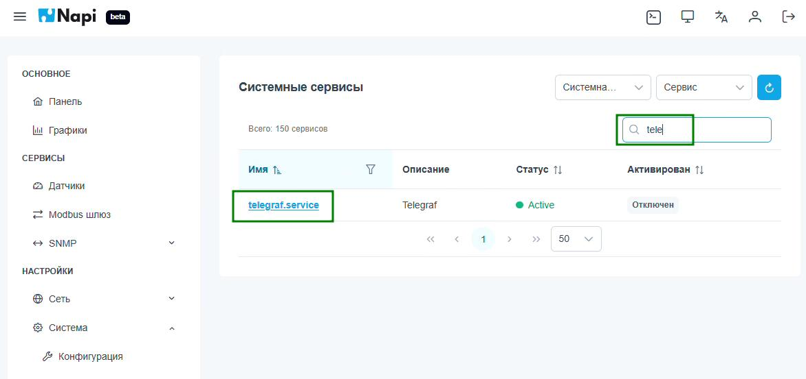
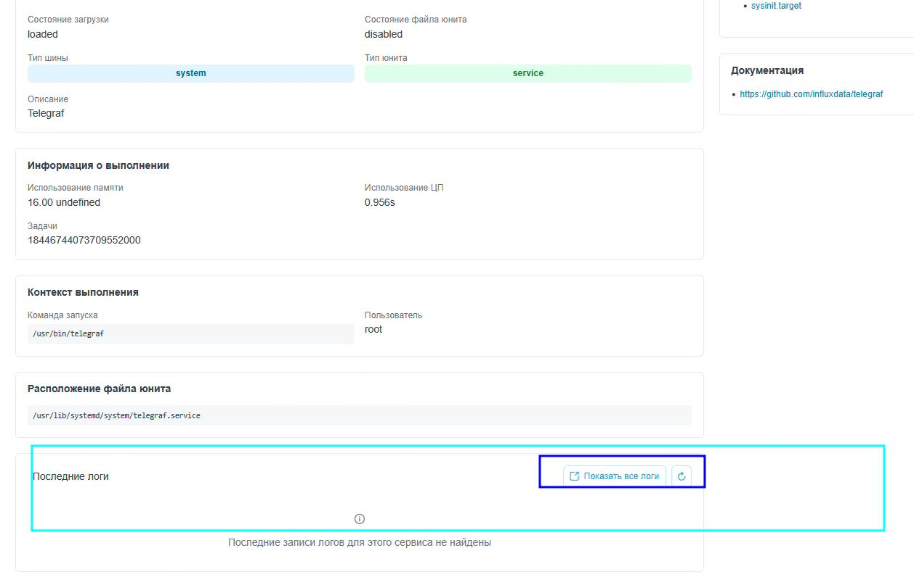
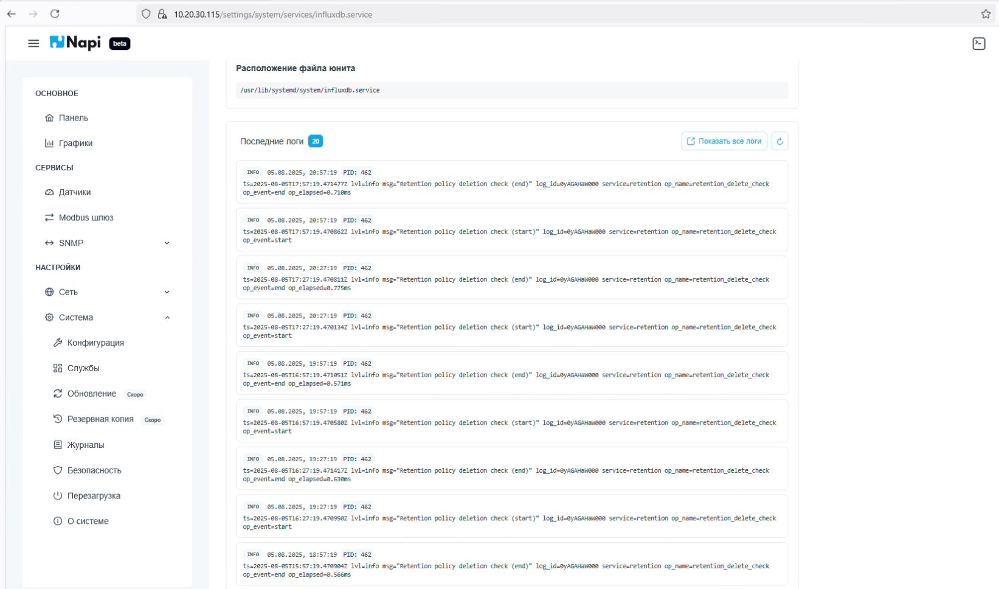
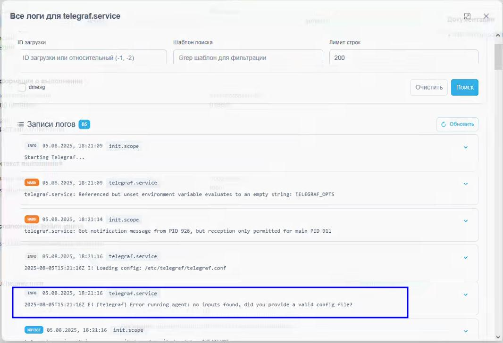

# Службы Linux и логи

Раздел **Настройки → Система → Службы** показывает службы systemd на устройстве.

## Список служб

В таблице для каждой службы указаны имя, описание, текущий статус (`Active` / `Inactive`) и включён ли автозапуск. Таблицу можно сортировать, а выпадающие списки вверху фильтруют её по типу шины (системные / пользовательские) и типу юнита (сервис, таймер и т. п.).

## Поиск службы

Поле поиска фильтрует список по имени и описанию. Например, если ввести `tele`, останется только `telegraf.service`:

## Карточка службы и последние логи

Если открыть службу, появится её подробная карточка:

- состояние загрузки и состояние файла юнита, тип шины и тип юнита;
- информация о выполнении: память, процессорное время, задачи;
- команда запуска и пользователь;
- расположение файла юнита;
- зависимости и ссылки на документацию;
- **Последние логи** — свежие записи журнала службы.

Так выглядят последние логи службы InfluxDB:

## Просмотр всех логов

Кнопка **Показать все логи** открывает журнал службы в отдельном окне. Там доступны фильтры:

- **ID загрузки** — логи конкретной загрузки системы (`-1` — предыдущая, `-2` — позапрошлая и т. д.);
- **Шаблон поиска** — фильтр в стиле grep;
- **Лимит строк**;
- **dmesg** — показать сообщения ядра.

У каждой записи есть уровень (INFO, NOTICE, WARN, ERROR), время и источник. Запись можно развернуть и посмотреть подробности. Это удобно при разборе проблем: на скриншоте видна ошибка Telegraf `no inputs found` — ни один датчик не активирован.

