# Шлюз SNMP v2c → SNMP v3

Многие устройства (PDU, ИБП, коммутаторы, датчики) отвечают только по **SNMP v2c**: данные и community передаются открытым текстом. Если требования безопасности сети предприятия разрешают только **SNMP v3**, устройство с NapiConfig можно использовать как шлюз (SNMP Proxy): клиент опрашивает шлюз по SNMP v3 с аутентификацией и шифрованием, а шлюз переводит запросы в SNMP v2c, отправляет их целевому устройству и возвращает ответ.

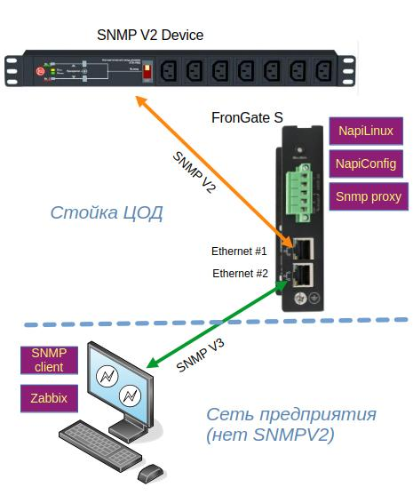

Типовая схема: одним Ethernet-портом шлюз подключён к сегменту с SNMP v2c-устройствами (например, к стойке ЦОД), другим — к сети предприятия, где работают SNMP-клиент или Zabbix.

## Подготовка

1. Настройте сетевые интерфейсы в разделе [Сеть](./network). Если используется два порта, настройте их по очереди.
2. Включите службу `snmpd` в разделе [Службы и логи](./services).
3. Проверьте, что целевое устройство отвечает по SNMP v2c, например в iReasoning MIB Browser (есть для Windows и Linux).

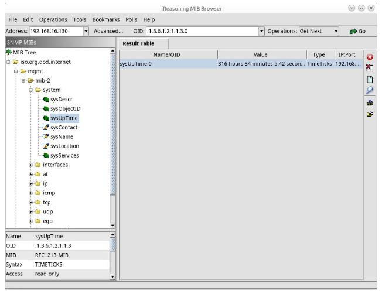

## Управление SNMP

Шлюз настраивается в разделе **Сервисы → SNMP → Management**.

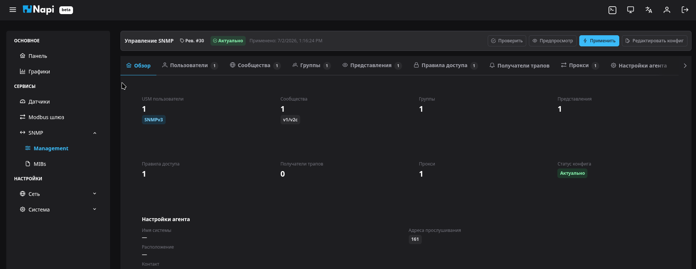

На вкладке **Обзор** показано, сколько создано пользователей, сообществ, групп, представлений, правил доступа, получателей трапов и прокси, а также статус конфигурации. Кнопки вверху страницы:

- **Проверить** — проверить конфигурацию;
- **Предпросмотр** — посмотреть итоговый `snmpd.conf`;
- **Применить** — записать конфигурацию и перезапустить службу;
- **Редактировать конфиг** — изменить `snmpd.conf` вручную.

Дальше по шагам настраивается пример: пользователь `userq` опрашивает по SNMP v3 устройство `192.168.16.194`, которое отвечает по SNMP v2c с community `public`.

### 1. Пользователь SNMP v3

Вкладка **Пользователи → + Новый пользователь**:

| Поле | Пример |
|---|---|
| Имя пользователя | `userq` |
| Протокол аутентификации | `SHA` |
| Пароль (аутентификация) | `authpassword` |
| Протокол шифрования | `AES` |
| Пароль (шифрование) | `privpassword` |

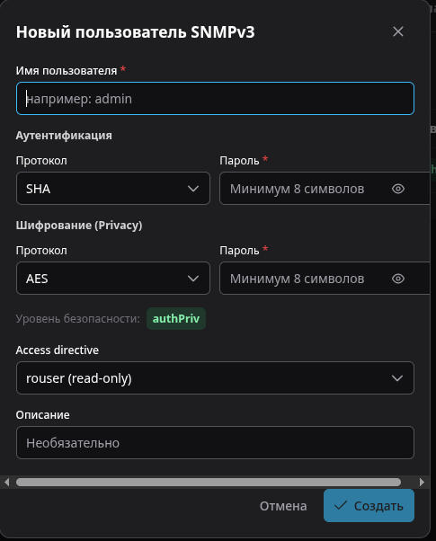

### 2. Сообщество

Вкладка **Сообщества → + Новое сообщество**. Имя сообщества: `public`.

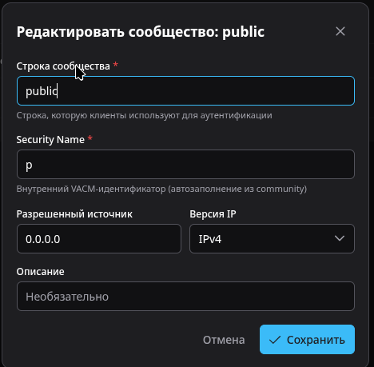

### 3. Группа

Вкладка **Группы → + Новая группа**. Имя группы: `red`. Добавьте в группу пользователя `userq`.

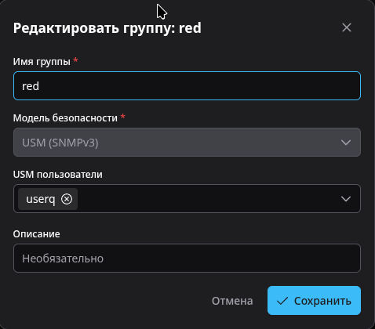

### 4. Представление

Вкладка **Представления → + Новое представление**. Имя представления: `sys`.

Представление определяет, какие ветки дерева OID доступны. Нажмите быстрый пресет **System** — в конфигурацию попадёт поддерево `.1.3.6.1.2.1.1`. Свои ветки можно добавить кнопкой **Добавить правило**.

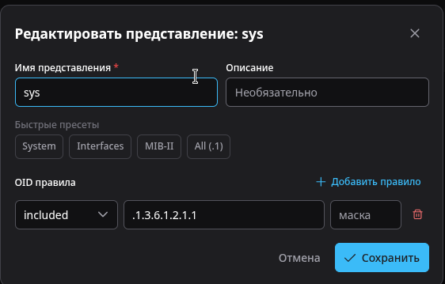

### 5. Прокси

Вкладка **Прокси → + Новый прокси**. Здесь указываются параметры опрашиваемого SNMP v2c-устройства:

| Поле | Пример | Описание |
|---|---|---|
| Имя | `qqqq` | Имя прокси |
| Транспорт | `UDP` | |
| Версия SNMP | `2c` | Версия протокола целевого устройства |
| Целевой хост | `192.168.16.194` | IP-адрес SNMP v2c-устройства |
| Целевой порт | `161` | |
| Сообщество | `public` | Read community целевого устройства |
| OID поддерево | `.1.3` | Какую часть дерева OID проксировать |
| Имя контекста | `ctx_qqqq` | SNMP v3-контекст, по которому клиент обращается к устройству |

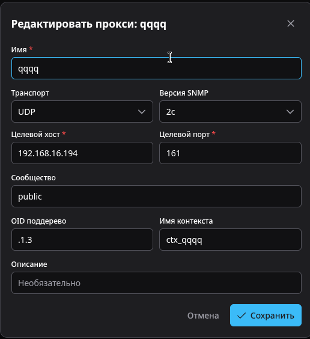

### 6. Правило доступа

Вкладка **Правила доступа → + Новое правило доступа**:

| Поле | Значение |
|---|---|
| Группа | `red` |
| Модель безопасности | `USM (v3)` |
| Уровень безопасности | `priv` |
| Сопоставление контекста | `exact` |
| Прокси | `qqqq` |
| Read View | `sys` |

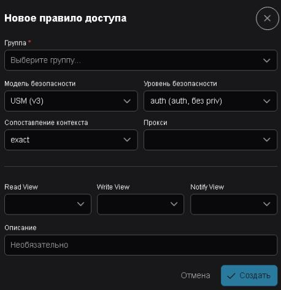

После настройки нажмите **Применить**.

## Итоговая конфигурация

Для примера выше NapiConfig формирует такой `snmpd.conf`:

```
# --- Agent ---
agentAddress 161
dontLogTCPWrappersConnects yes

# --- USM Users ---
createUser userq SHA "authpassword" AES "privpassword"
rouser userq

# --- Security Names (com2sec) ---
com2sec p 0.0.0.0 public

# --- Groups ---
group red usm userq

# --- Views ---
view sys included .1.3.6.1.2.1.1

# --- Access ---
access red "ctx_qqqq" usm priv exact sys none none

# --- Proxy ---
proxy -Cn ctx_qqqq -v 2c -c public 192.168.16.194:161 .1.3
```

## Проверка

### Локально на шлюзе

В [Терминале](./terminal) выполните:

```bash
snmpwalk -v2c -c public localhost sysName
snmpwalk -v2c -c public localhost
```

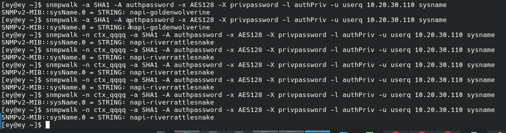

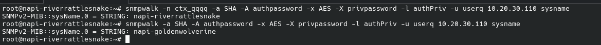

### Доступность шлюза по SNMP v3

С клиента в сети предприятия (`10.20.30.110` — адрес шлюза):

```bash
snmpwalk -a SHA -A authpassword -x AES -X privpassword \
  -l authPriv -u userq 10.20.30.110 sysName
```

В ответе — имя самого шлюза:

```
SNMPv2-MIB::sysName.0 = STRING: napi-goldenwolverine
```

### Опрос устройства через контекст

Добавьте контекст прокси `-n ctx_qqqq`:

```bash
snmpwalk -n ctx_qqqq -a SHA -A authpassword -x AES -X privpassword \
  -l authPriv -u userq 10.20.30.110 sysName
```

В ответе — имя целевого SNMP v2c-устройства:

```
SNMPv2-MIB::sysName.0 = STRING: napi-riverrattlesnake
```

:::note

Утилиты Net-SNMP для Windows: https://sourceforge.net/projects/net-snmp/files/net-snmp%20binaries/

:::
