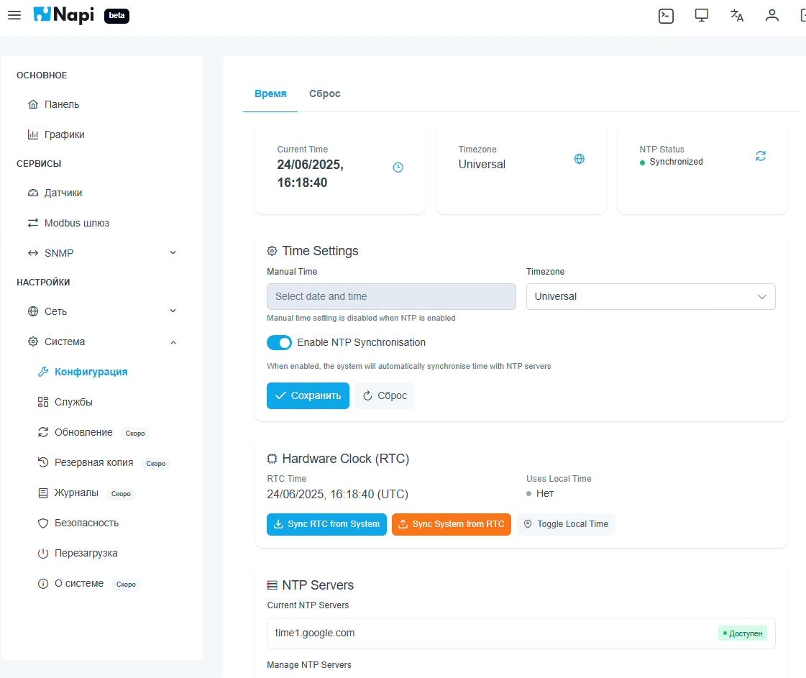
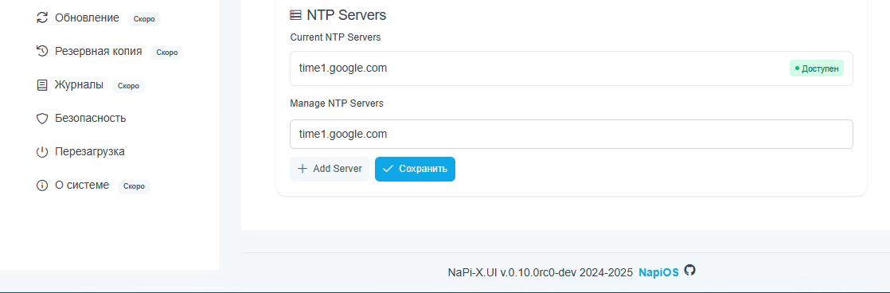
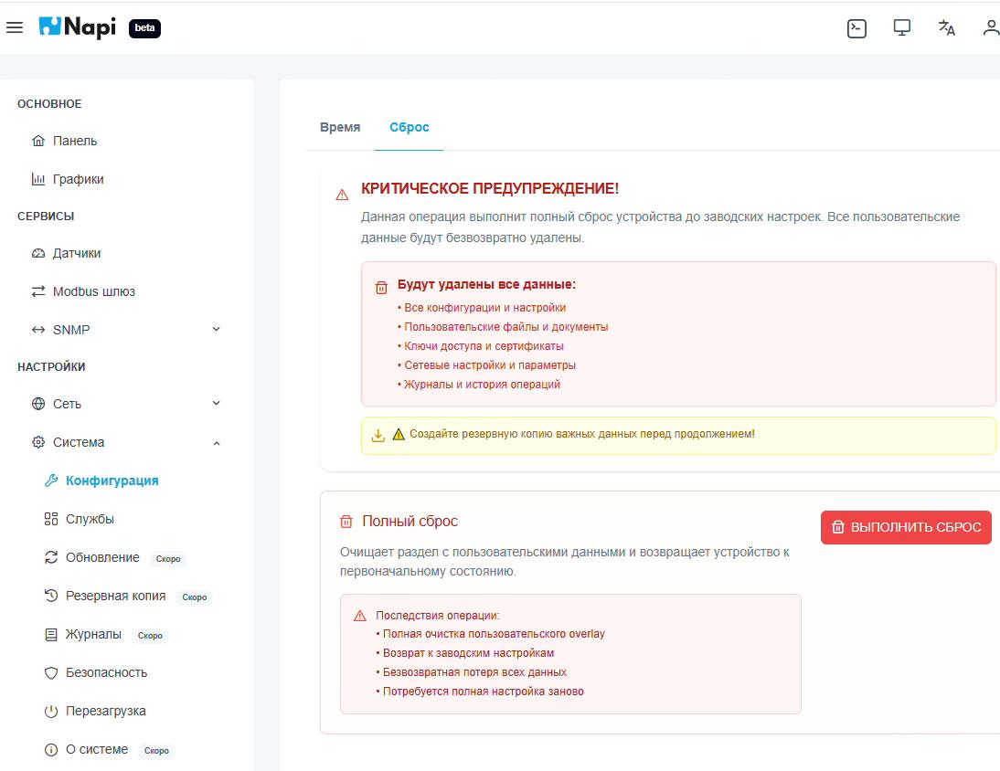

# Система: время и сброс

Раздел **Настройки → Система → Конфигурация** состоит из двух вкладок: **Время** и **Сброс**.

## Дата и время

Вверху вкладки **Время** показаны текущее время устройства, часовой пояс и статус синхронизации NTP.

**Time Settings**:

- **Timezone** — часовой пояс;
- **Enable NTP Synchronisation** — автоматическая синхронизация времени с NTP-серверами;
- **Manual Time** — ручная установка даты и времени. Доступна только при выключенном NTP.

**Hardware Clock (RTC)** — аппаратные часы:

- **Sync RTC from System** — записать системное время в RTC;
- **Sync System from RTC** — установить системное время по RTC;
- **Toggle Local Time** — хранить в RTC местное время или UTC.

## NTP-серверы

Блок **NTP Servers** показывает текущие серверы и их доступность. Сервер добавляется кнопкой **Add Server**, изменения — кнопкой **Сохранить**.

## Сброс к заводским настройкам

На вкладке **Сброс** выполняется полный сброс устройства: очищается пользовательский раздел (overlay), и система возвращается в исходное состояние.

Удаляются:

- все конфигурации и настройки;
- пользовательские файлы;
- ключи доступа и сертификаты;
- сетевые настройки;
- журналы и история операций.

:::danger
Сброс необратим. Перед сбросом сохраните важные данные и конфигурации датчиков. После сброса устройство придётся настраивать заново, включая сеть.
:::
