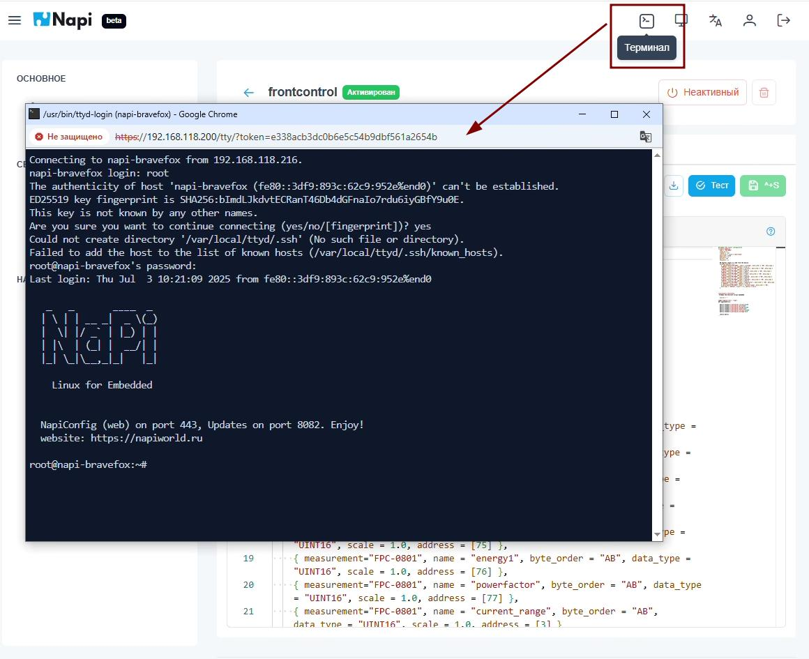
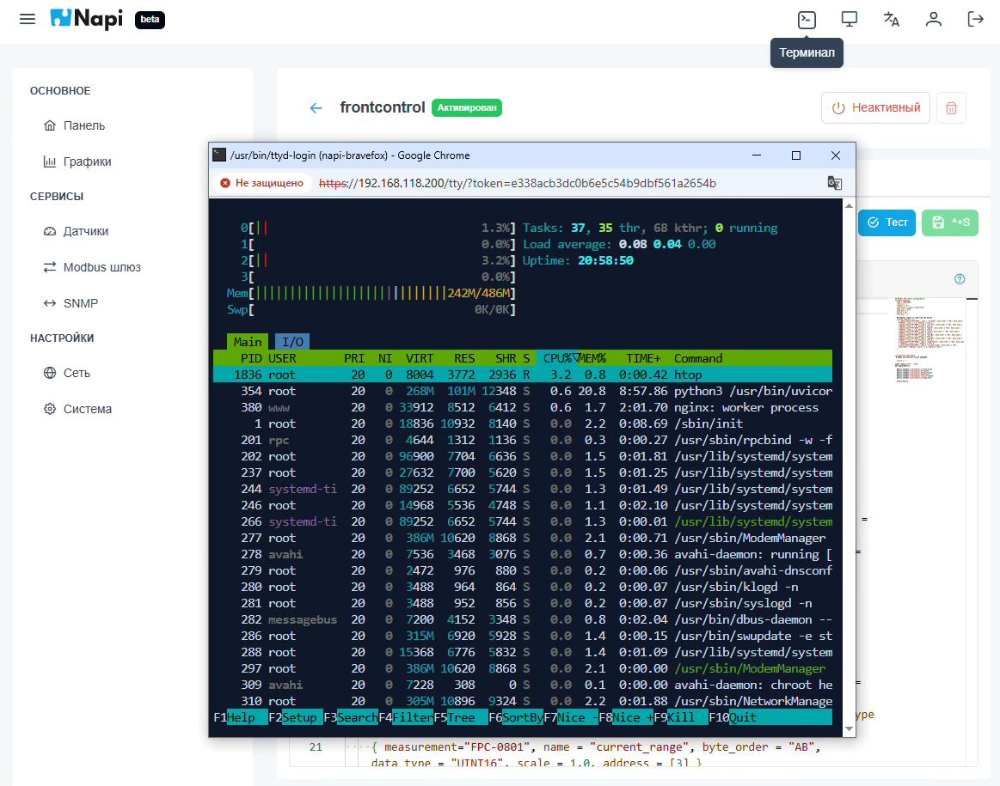

# Веб-терминал

В NapiConfig встроен SSH-терминал: в консоль устройства можно зайти прямо из браузера, без отдельного SSH-клиента.

Терминал открывается кнопкой **Терминал** в правом верхнем углу (значок `>_`). Он запускается в отдельном окне браузера и подключается к устройству по SSH. Для входа используйте системного пользователя Linux (например, `root`), а не учётную запись NapiConfig.

В терминале работают полноэкранные консольные программы: `htop`, `mc`, `nano` и другие.

:::tip
Терминал удобен, когда нужно быстро проверить что-то на устройстве, а SSH-клиента под рукой нет. Например, посмотреть процессы или отредактировать файл.
:::
